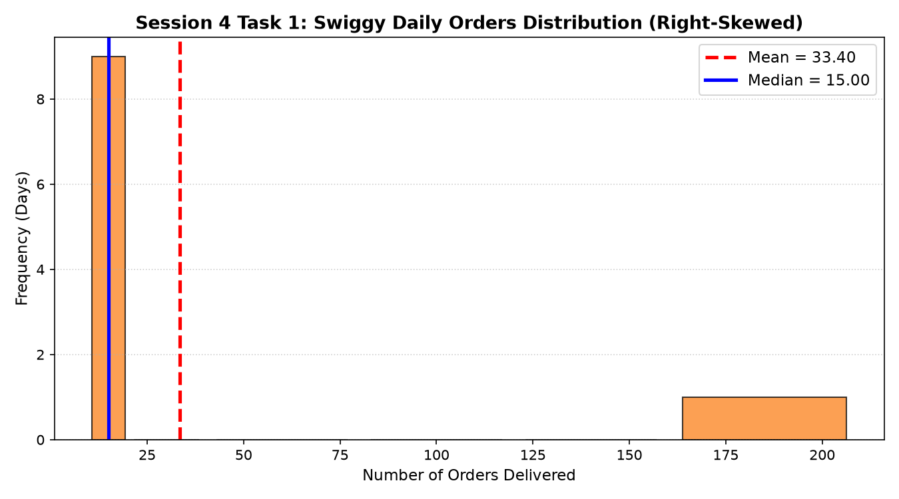
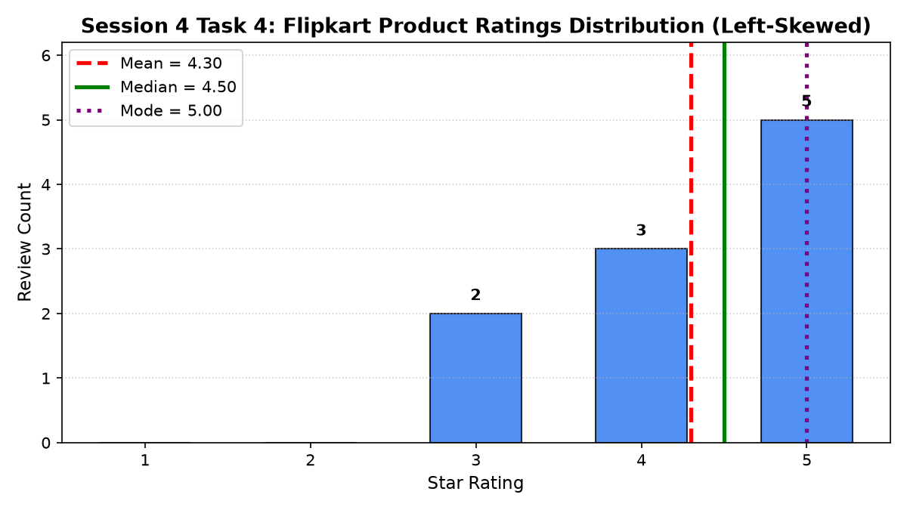

# Session 4 - Skewness (Basic)

This directory contains the solutions, statistical reasoning, Python code, distribution plots, and Jupyter Notebook for **Session 4: Skewness (Basic)**.

---

## Overview of Tasks

| Task | Topic | Shape / Classification | Key Deliverables |
|---|---|---|---|
| **Task 1** | Swiggy Delivery Orders | **Right-Skewed** | Daily orders distribution plot, reasoning on 200-order outlier. |
| **Task 2** | Instagram Influencer Followers | **Right-Skewed** | Calculation of Mean ($18.78\text{k}$) vs Median ($9.00\text{k}$) and interpretation. |
| **Task 3** | Real-World App Example | **Right-Skewed** | Detailed description of Zomato customer order amounts (basket sizes in INR). |
| **Task 4** | Flipkart Product Ratings | **Left-Skewed** | Bar graph visualization, calculation, and one-line justification. |

---

## Task Details & Solutions

### Task 1: Swiggy Daily Order Counts Skewness & Plot

> **Prompt:** Given the daily order counts for a Swiggy delivery partner over 10 days: `[12, 15, 17, 14, 13, 16, 200, 18, 14, 15]`, plot a simple graph (hand-drawn or using any tool) and describe whether the data is left skewed, right skewed, or symmetrical. Explain your reasoning based on the shape.

#### Summary Statistics:
- **Daily Orders:** `[12, 15, 17, 14, 13, 16, 200, 18, 14, 15]`
- **Sorted:** `[12, 13, 14, 14, 15, 15, 16, 17, 18, 200]`
- **Mean Orders:** $\frac{334}{10} = \mathbf{33.40}$
- **Median Orders:** $\frac{15 + 15}{2} = \mathbf{15.00}$
- **Mode Orders:** $14$ and $15$ (each occurs twice)

#### Distribution Classification:
**Right-Skewed (Positively Skewed)**

#### Reasoning based on shape:
1. **Cluster on the Left:** $90\%$ of the observations ($9$ out of $10$ days) are tightly gathered in the narrow range between $12$ and $18$ orders, creating a steep, tall peak at the low end.
2. **Elongated Right Tail:** The single massive outlier of $200$ orders (e.g., a festival catering drive) stretches the distribution's tail far out to the right.
3. **Mean vs. Median:** Because the extreme value inflates the arithmetic mean ($\mathbf{33.40}$) well above the median ($\mathbf{15.00}$), the data displays classic right skewness ($\text{Mean} > \text{Median}$).



---

### Task 2: Instagram Influencer Followers Mean vs. Median & Skewness

> **Prompt:** Take the following list of Instagram influencer follower counts (in thousands): `[5, 7, 8, 8, 9, 10, 12, 15, 95]`. Calculate the mean and median, then state which is higher and what that tells you about the skewness of the data.
>
> *Hint: If the mean is pulled away from the median, the data is skewed in that direction.*

#### Calculations:
- **Sum:** $5 + 7 + 8 + 8 + 9 + 10 + 12 + 15 + 95 = 169$
- **Mean:** $\frac{169}{9} \approx \mathbf{18.78\text{ thousand followers}}$ ($18,778$)
- **Median:** Middle value ($5^{\text{th}}$ element of $9$ sorted values) = $\mathbf{9.00\text{ thousand followers}}$ ($9,000$)

#### Comparison:
- **The Mean ($18.78\text{k}$) is substantially higher than the Median ($9.00\text{k}$)** by $+9.78\text{k}$.

#### What this tells about Skewness:
- Because the mean is pulled strongly upwards away from the median by the $95\text{k}$ mega-influencer outlier, the dataset is **Right-Skewed (Positively Skewed)**.
- This confirms that typical creators have modest audiences ($5\text{k}$–$15\text{k}$), while a rare few have viral reach, creating an extended right tail.

---

### Task 3: Real-World Example of Right-Skewed App Data

> **Prompt:** Find a real-world example of right-skewed data from any app you use (like Zomato order amounts, Paytm wallet balances, or YouTube video views). Briefly describe the dataset and explain why you think it is right skewed.

#### Selected Example: **Zomato Customer Order Amounts (Basket Size in INR)**

1. **Dataset Description:**  
   A collection of the total bill amounts paid (in INR) across thousands of food delivery orders placed on Zomato across a city during a weekend evening.

2. **Why It Is Right-Skewed (Reasoning):**
   - **Hard Lower Bound:** An order total cannot be negative, and restaurants enforce minimum basket thresholds (rarely below ₹120–₹150).
   - **Central Cluster (Mode):** The overwhelming majority of orders are everyday meals for $1$ or $2$ people, concentrating heavily between **₹250 and ₹450**.
   - **Unbounded Upper Tail:** A small percentage of orders consist of office lunches, family celebrations, or luxury dining orders reaching **₹4,000, ₹10,000, or even ₹30,000+**.
   - **Result:** These rare high-value transactions stretch the tail far out towards the positive (right) side, pulling the Mean order value significantly higher than the Median order value.

---

### Task 4: Flipkart Product Ratings Skewness & Graph

> **Prompt:** Given this dataset of Flipkart product ratings: `[3, 3, 4, 4, 4, 5, 5, 5, 5, 5]`, draw a rough graph and state if the distribution is symmetrical, left skewed, or right skewed. Justify your answer in one line.

#### Frequency & Statistics:
- **Ratings:** `[3, 3, 4, 4, 4, 5, 5, 5, 5, 5]` ($n = 10$)
- **Frequency:** $3\text{ stars} \rightarrow 2,\; 4\text{ stars} \rightarrow 3,\; 5\text{ stars} \rightarrow 5$
- **Mean:** $\frac{3(2) + 4(3) + 5(5)}{10} = \frac{43}{10} = \mathbf{4.30}$
- **Median:** $\frac{4 + 5}{2} = \mathbf{4.50}$
- **Mode:** $\mathbf{5.00}$ (appears 5 times)

#### ASCII Frequency Graph:
```text
  1 Star |                        (0)
  2 Star |                        (0)
  3 Star | ########               (2)
  4 Star | ############           (3)
  5 Star | ####################   (5)
```

#### Classification:
**Left-Skewed (Negatively Skewed)**

#### One-Line Justification:
> *"The distribution is left-skewed because ratings concentrate heavily at the high end (5 stars), stretching a tail towards lower ratings on the left, resulting in $\text{Mean } (4.30) < \text{Median } (4.50) < \text{Mode } (5.00)$."*



---

## How to Run

1. Execute Python script (prints analysis and saves plots):
   ```bash
   python session_4.py
   ```
2. Interactive Jupyter Notebook:
   ```bash
   jupyter notebook session_4.ipynb
   ```
