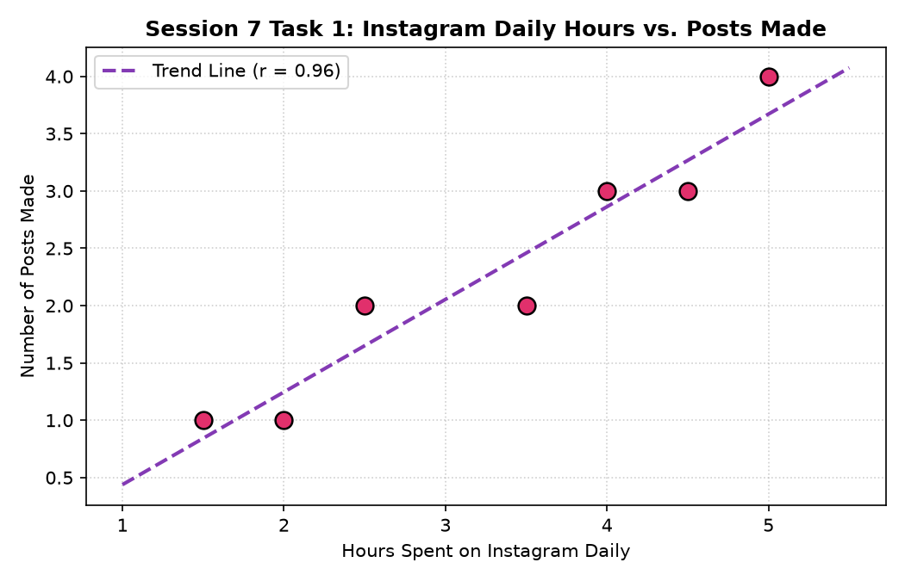
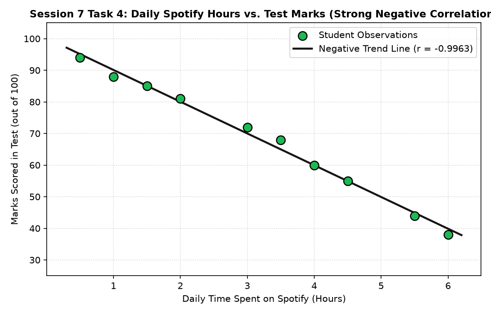

# Session 7 - Correlation

This directory contains the solutions, statistical calculations, matplotlib scatter plots, and an interactive Jupyter Notebook for **Session 7: Correlation**.

---

## Overview of Tasks

| Task | Topic | Variables Analyzed | Correlation Type ($r$) | Deliverables |
|---|---|---|---|---|
| **Task 1** | Social Media Activity | Daily Instagram Hours vs. Posts Made | **Strong Positive** ($r \approx 0.96$) | Scatter plot with upward trend line. |
| **Task 2** | Food Delivery Comparison | 6 Friends: Zomato vs. Swiggy Orders | **Strong Positive** ($r \approx 0.996$) | NumPy correlation matrix via `np.corrcoef()`. |
| **Task 3** | Daily Life Reflection | Screen Entertainment vs. Study Hours | **Strong Negative** ($r < 0$) | Comprehensive analytical paragraph. |
| **Task 4** | Spotify Time vs. Exam Marks | 10 Pairs Generated Dataset | **Strong Negative** ($r \approx -0.996$) | Scatter plot with regression fit line. |

---

## Task Details & Solutions

### Task 1: Instagram Hours vs. Posts Created (Scatter Plot)

> **Prompt:** Create two Python lists: one representing the number of hours you spend on Instagram each day for a week, and another for the number of posts you make each day. Plot these as a scatter plot using matplotlib and visually describe whether the relationship looks like a positive, negative, or zero correlation.

#### Data:
- **Daily Hours on Instagram ($X$):** `[1.5, 2.0, 3.5, 2.5, 4.0, 5.0, 4.5]`
- **Daily Posts Made ($Y$):** `[1, 1, 2, 2, 3, 4, 3]`
- **Pearson Correlation:** $r = \mathbf{0.9576}$

#### Visual Description & Relationship:
- **Classification:** **Strong Positive Correlation**
- **Reasoning:**
  1. The scatter plot displays an upward-sloping trajectory moving from the bottom-left quadrant towards the top-right quadrant.
  2. As the daily time dedicated to Instagram increases (from 1.5 to 5.0 hours), the number of posts/stories created increases proportionately (from 1 to 4 posts).
  3. The correlation coefficient $r \approx 0.96$ confirms that the two variables share a strong, direct linear association.



---

### Task 2: Zomato vs. Swiggy Order Count Correlation (`np.corrcoef`)

> **Prompt:** Given the following data for 6 friends: their monthly Zomato order count and their monthly Swiggy order count, calculate the correlation coefficient between the two lists using numpy's corrcoef(). Print the result and explain if the correlation is positive, negative, or zero.

#### Data for 6 Friends:
| Friend | Monthly Zomato Orders ($X$) | Monthly Swiggy Orders ($Y$) |
|:---:|:---:|:---:|
| Friend 1 | $18$ | $16$ |
| Friend 2 | $12$ | $10$ |
| Friend 3 | $25$ | $24$ |
| Friend 4 | $8$ | $7$ |
| Friend 5 | $15$ | $14$ |
| Friend 6 | $22$ | $20$ |

#### Calculation using NumPy:
```python
import numpy as np

zomato_orders = [18, 12, 25, 8, 15, 22]
swiggy_orders = [16, 10, 24, 7, 14, 20]

corr_matrix = np.corrcoef(zomato_orders, swiggy_orders)
r = corr_matrix[0, 1]
print(f"Correlation: {r:.4f}")  # 0.9962
```

#### Explanation of Correlation:
- **Direction & Strength:** **Strong Positive Correlation ($r = \mathbf{0.9962}$)**.
- **Interpretation:**
  1. The correlation coefficient is extremely close to $+1.00$, indicating a near-perfect positive linear relationship.
  2. Friends with high appetite for food delivery order frequently on **both** Zomato and Swiggy, while friends who prefer home-cooked food order minimally on both apps.
  3. The platforms complement each other across food-loving users rather than acting as strict substitutes.

---

### Task 3: Two Real-Life Variables — Expected Correlation & Why

> **Prompt:** Think of two variables from your daily life (for example, number of YouTube videos watched per day and daily study hours). Write a short paragraph describing whether you expect a positive, negative, or zero correlation between them, and why.

#### Selected Daily Life Variables:
- **Variable $X$:** Daily hours spent on YouTube / non-academic screen entertainment.
- **Variable $Y$:** Daily hours spent on focused study and coding practice.

#### Paragraph Description & Justification:
> *"I expect a **strong negative correlation** ($r < 0$) between daily YouTube entertainment hours and daily study hours. Every day presents a finite budget of roughly 16 waking hours. Non-academic video consumption directly consumes both available time and cognitive focus that would otherwise be dedicated to deep work and academic study. On unproductive days with excessive video watching (5–7 hours), study time drops sharply to 0–1 hour. Conversely, on disciplined days with 6+ hours of intense study and programming, entertainment screen time drops under an hour. Because the two variables move in opposite directions, their relationship exhibits an inverse, negative correlation."*

---

### Task 4: Spotify Time vs. Test Marks (Strong Negative Correlation)

> **Prompt:** Use ChatGPT to generate a small dataset (10 pairs of numbers) that shows a strong negative correlation between time spent on Spotify and marks scored in a test. Paste the dataset and plot it as a scatter plot using matplotlib.
>
> *Hint: Ask ChatGPT to "generate 10 pairs of numbers with a strong negative correlation" and specify your variables.*

#### 10 Pairs Dataset:
- **Daily Spotify Hours ($X$):** `[0.5, 1.0, 1.5, 2.0, 3.0, 3.5, 4.0, 4.5, 5.5, 6.0]`
- **Test Marks Scored ($Y$):** `[94, 88, 85, 81, 72, 68, 60, 55, 44, 38]`
- **Calculated Correlation:** $r = \mathbf{-0.9963}$



#### Interpretation:
- As daily hours spent streaming music/podcasts during study hours increase from $0.5$ to $6.0$ hours, test scores drop steadily from $94$ to $38$.
- The downward-sloping regression line and correlation coefficient $r \approx -1.0$ confirm a nearly perfect negative correlation.

---

## How to Run

1. Run the Python script:
   ```bash
   python session_7.py
   ```
2. Open the Jupyter Notebook:
   ```bash
   jupyter notebook session_7.ipynb
   ```
