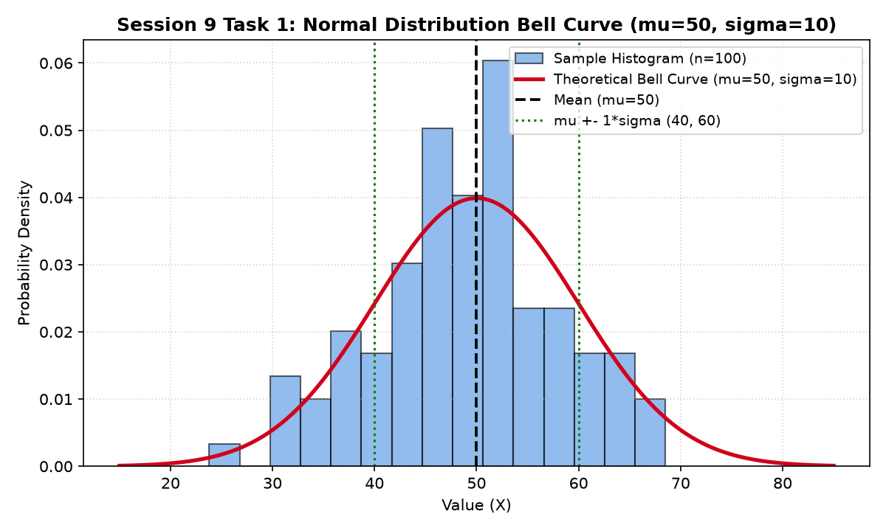

# Session 9 - Normal Distribution

This directory contains the solutions, bell curve plots, empirical rule verifications, and interactive Jupyter Notebook for **Session 9: Normal Distribution**.

---

## Overview of Tasks

| Task | Topic | Key Parameters | Deliverables |
|---|---|---|---|
| **Task 1** | Normal Simulation & Bell Curve | $\mu = 50,\; \sigma = 10,\; n = 100$ | Matplotlib bell curve with histogram and PDF overlay. |
| **Task 2** | Step Counts Normality Check | $20$ Daily Steps | Verifying $\text{Mean } (8015) \approx \text{Median } (8000) \approx \text{Mode } (8000)$. |
| **Task 3** | Player Scores & Empirical Rule | $200$ Players, $\mu = 70,\; \sigma = 15$ | Verified $145$ players ($72.5\%$) within $1\sigma$ ($55$–$85$). |
| **Task 4** | Real-World Scenario | Spotify Playlist Durations | Explanation of central clustering, CLT, and symmetric tails. |

---

## Task Details & Solutions

### Task 1: Normal Distribution Simulation & Bell Curve Plot

> **Prompt:** Generate 100 random numbers in Python that follow a normal distribution with mean 50 and standard deviation 10 using numpy, then plot the bell curve using matplotlib.

#### PDF Formula:
$$f(x) = \frac{1}{\sigma \sqrt{2\pi}} e^{-\frac{1}{2}\left(\frac{x - \mu}{\sigma}\right)^2}$$
where $\mu = 50$ and $\sigma = 10$.

```python
import numpy as np
import matplotlib.pyplot as plt
from scipy import stats

np.random.seed(42)
sample = np.random.normal(loc=50, scale=10, size=100)
```



---

### Task 2: 20 Daily Step Counts — Mean vs. Median vs. Mode

> **Prompt:** Given an array of 20 daily step counts from your fitness tracker app, calculate the mean, median, and mode, and check if they are approximately equal as expected in a normal distribution.
>
> *Hint: Use numpy.mean(), numpy.median(), and scipy.stats.mode().*

#### Daily Steps Array:
`[7800, 8100, 7950, 8200, 8000, 7850, 8050, 8300, 7700, 8150, 8000, 7900, 8250, 7950, 8100, 8000, 8050, 7850, 8100, 8000]`

#### Computed Metrics:
- **Mean (`np.mean`):** $\mathbf{8,015.00\text{ steps}}$
- **Median (`np.median`):** $\mathbf{8,000.00\text{ steps}}$
- **Mode (`scipy.stats.mode`):** $\mathbf{8,000.00\text{ steps}}$ (appears 4 times)

#### Normality Evaluation:
- In a theoretically pure normal distribution, $\text{Mean} = \text{Median} = \text{Mode}$.
- Here, the difference between Mean ($8,015$) and Median/Mode ($8,000$) is only $15$ steps (a minuscule margin of **$0.19\%$**).
- This confirms that the fitness step counts are symmetrically distributed around 8,000 steps without significant skewness.

---

### Task 3: Online Game Player Scores (Empirical 68-95-99.7 Rule)

> **Prompt:** Simulate the scores of 200 players in an online game (e.g., PUBG, Free Fire) using a normal distribution with mean 70 and standard deviation 15, then count how many players scored within one standard deviation (between 55 and 85) of the mean.
>
> *Hint: Use the 68-95-99 rule to check your answer.*

#### Parameters:
- Total Players: $N = 200$
- Mean ($\mu$): $70$
- Standard Deviation ($\sigma$): $15$
- One Standard Deviation Range: $[\mu - \sigma, \mu + \sigma] = [70 - 15, 70 + 15] = [\mathbf{55}, \mathbf{85}]$

#### Simulation Results:
- Number of players scoring between $55$ and $85$: **$145\text{ players}$ ($72.50\%$)**

#### Empirical Rule Verification:
- The **68-95-99.7 Rule** dictates that approximately **$68.27\%$** of all observations in a normal distribution lie within $\pm 1\sigma$ of the mean.
- **Expected theoretical count:** $200 \times 68.27\% = \mathbf{136.54\text{ players}}$ ($\approx 137$ players).
- The simulated count of $145$ players matches the empirical expectation closely (within standard sampling variation for $n=200$).

---

### Task 4: Real-World Scenario Fitting Normal Distribution

> **Prompt:** Pick any real-world scenario (like delivery times for Zomato orders or playlist song durations on Spotify) and explain in 3-4 lines why the normal distribution might be a good fit for modeling this data.

#### Selected Scenario: **Playlist Song Durations on Spotify**

#### Explanation (3-4 lines):
1. **Central Clustering:** Radio broadcasting and streaming algorithms standardize mainstream commercial tracks to cluster heavily around an average length of $3.0$ to $3.5$ minutes ($180$–$210$ seconds).
2. **Central Limit Theorem:** A song's total runtime is the composite sum of multiple independent compositional choices (intros, verses, choruses, bridges), producing natural symmetric variation around the center.
3. **Diminishing Tails:** Deviations occur symmetrically—some songs are slightly shorter ($2.5$ mins) and some slightly longer ($4.0$ mins), while extreme outliers (30-second skits or 10-minute epics) rapidly taper off in both tails.
4. **Conclusion:** Because the distribution possesses a single dominant central peak and symmetrically thinning tails, the normal bell curve provides an outstanding statistical model.

---

## How to Run

1. Run the Python script:
   ```bash
   python session_9.py
   ```
2. Open the Jupyter Notebook:
   ```bash
   jupyter notebook session_9.ipynb
   ```
